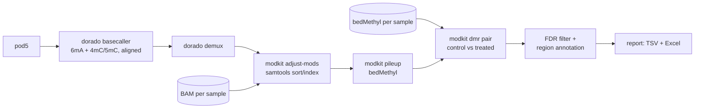

# METION

**Bacterial DNA methylation (6mA, 5mC, 4mC) from Oxford Nanopore reads — a Nextflow pipeline.**

[](https://github.com/mario-garcia-calleja/metion/actions/workflows/ci.yml)


METION finds the DNA methylation sites that change between a control strain and a treated or
resistant strain, tests them statistically and reports which ones fall in genes of interest and
their upstream (promoter) regions. It was developed for my Bachelor's thesis on *Escherichia coli*
strains with different levels of quinolone resistance, and works with any bacterial genome given its
reference FASTA and a BED file of regions.

Companion pipeline: [SNIGRON](https://github.com/mario-garcia-calleja/snigron) (SNPs, indels and integrons).



## Background

Bacteria methylate their DNA mainly through methyltransferases of restriction–modification systems
and orphan enzymes such as Dam and Dcm. These marks regulate gene expression, DNA replication and
mismatch repair, and changes in methylation have been linked to antibiotic tolerance and resistance.
Oxford Nanopore sequencing reads 6mA, 5mC and 4mC directly from native DNA, but going from raw
signal to "which methylation sites changed in resistance genes" needs several tools glued together
with consistent statistics. METION packages that analysis into one reproducible workflow.

## What it does

1. **Basecalling** with Dorado using all-context modification models (`6mA`, `4mC_5mC`), alignment to the reference and barcode demultiplexing.
2. **Pileup** of modification calls per sample with `modkit pileup`, in all sequence contexts by default. Bacterial methyltransferases such as Dam (6mA at `GATC`) and Dcm (5mC at `CCWGG`) do not act on CpG, so CpG-only analysis misses most bacterial methylation.
3. **Differential methylation** for every control/treated pair with `modkit dmr pair`.
4. **Statistics and annotation**: sites are kept when both samples have enough coverage, the change in methylated fraction is large enough and the Benjamini–Hochberg FDR is below the threshold. Significant sites are annotated with the regions they fall in, including a strand-aware upstream window.

## Quick start

```bash
git clone https://github.com/mario-garcia-calleja/metion.git
nextflow run metion/main.nf -profile test,conda          # synthetic data, ~1 min
```

```bash
nextflow run metion/main.nf -profile conda \
    --pod5 run01/pod5/ \
    --samplesheet samplesheet.csv \
    --comparisons comparisons.csv \
    --reference GCA_000005845.2_ASM584v2_genomic.fna \
    --regions metion/assets/ecoli_k12_quinolone_resistance.bed \
    --max_cpus 32 --max_memory 250.GB
```

## Inputs

**Samplesheet.** Each sample starts from one of three points. Relative paths are resolved against the samplesheet's folder.

```csv
sample,barcode,bam,bedmethyl
control_A,09,,
resistant_A,08,,
control_B,,bams/control_B.bam,
resistant_B,,,pileups/resistant_B.bed.gz
```

| Column | Starts at | Notes |
|---|---|---|
| `barcode` | basecalling | requires `--pod5` |
| `bam` | pileup | aligned BAM with MM/ML modification tags |
| `bedmethyl` | comparison | bgzipped bedMethyl with its `.tbi` alongside |

**Comparisons**

```csv
comparison,control,treated
pair_A,control_A,resistant_A
pair_B,control_B,resistant_B
```

**Regions**: any BED file (`chrom start end name score strand`) whose chromosome names match the reference.
`assets/ecoli_k12_quinolone_resistance.bed` lists 21 *E. coli* K-12 MG1655 genes involved in quinolone and multidrug resistance.

## Parameters

| Parameter | Default | Description |
|---|---|---|
| `--dorado_model` | `hac` | Model name/complex, or path to a downloaded model |
| `--dorado_modified_bases` | `6mA 4mC_5mC` | Modification models (see `dorado download --list`) |
| `--dorado_kit` | `SQK-RBK114-24` | Barcoding kit |
| `--dorado_mod_models` | | Comma-separated paths to downloaded modification models (offline use; overrides `--dorado_modified_bases`) |
| `--dorado_device` | `cuda:all` | Use `cpu` for small tests (slow) |
| `--ignore_mods` | `h` | Codes removed with `modkit adjust-mods` (`none` keeps all) |
| `--pileup_args` | | Extra `modkit pileup` options, e.g. `--motif GATC 1` |
| `--dmr_bases` | `A,C` | Primary bases compared |
| `--fdr` | `0.05` | Benjamini–Hochberg threshold |
| `--min_effect` | `0.2` | Minimum difference in fraction methylated |
| `--min_coverage` | `5` | Minimum valid coverage in both samples |
| `--flank` | `200` | bp upstream of each region also reported (both sides when strand is `.`) |
| `--legacy` | `false` | Reproduce the v1 filtering (see [CHANGELOG](CHANGELOG.md)) |
| `--max_cpus` / `--max_memory` | `16` / `64.GB` | Upper limits for any single task |

## Example

Running the bundled test (`-profile test`) compares two synthetic control/treated pairs in which the
treated strains lose Dam methylation inside `gene_B`. `metion_summary.tsv`:

| region | mod | pair1_hyper | pair1_hypo | pair2_hyper | pair2_hypo |
|---|---|---|---|---|---|
| gene_B | 6mA | 0 | 11 | 0 | 11 |

## Outputs

```
results/
├── pileup/       <sample>.bed.gz (+ .tbi, log)       per-sample bedMethyl
├── dmr/          <comparison>.dmr.bed                 raw per-site comparison from modkit
├── report/
│   ├── comparisons/   significant sites, sites in regions, summary and stats per comparison
│   ├── metion_summary.tsv   region × modification: hyper/hypo-methylated sites per comparison
│   ├── metion_stats.tsv     sites tested / significant per comparison
│   └── metion_report.xlsx   all of the above in one workbook
└── pipeline_info/  Nextflow timeline, report and trace
```

## Installation

- [Nextflow](https://www.nextflow.io/) ≥ 24.04 and Conda, Mamba or Micromamba. Each process declares its own Bioconda environment (`modkit 0.4.3`, `samtools 1.21`, `htslib 1.21`).
- [Dorado](https://github.com/nanoporetech/dorado) is not on Bioconda: install it and put it on `PATH` (or use `--dorado_bin`). Only needed when starting from pod5; modification calling is practical only on a GPU.

Profiles: `conda`, `mamba`, `micromamba`, `slurm`, `test`.

## Testing

```bash
conda env create -f environment.yml && conda activate metion
pytest tests/python                      # unit tests (FDR, annotation, legacy mode)
python tests/make_test_data.py           # regenerate the synthetic dataset
nextflow run main.nf -profile test -stub-run
```

GitHub Actions runs the unit tests and a stub run on every push. Test data are simulated: no sequencing data from the original study are distributed.

## Limitations

- Per-site statistics come from `modkit dmr pair` (one replicate per condition). With biological
  replicates, a model that accounts for between-replicate variance is preferable.
- Methylation calling on CPU is only practical for small tests; use a GPU for real runs.
- Regions are annotated by coordinates; strand-aware upstream windows require a strand in the BED.

## Author

**Mario García Calleja** — [LinkedIn](https://www.linkedin.com/in/mariogarciacalleja/)

Acknowledgements: Dra. Marta Hernández Pérez and Dr. José María Eiros (supervision), Dr. Lucas
Domínguez Rodríguez (VISAVET, Universidad Complutense de Madrid), and Jorge González Gilbaja for the
initial Nextflow template of the basecalling step.

## License

[MIT](LICENSE)
